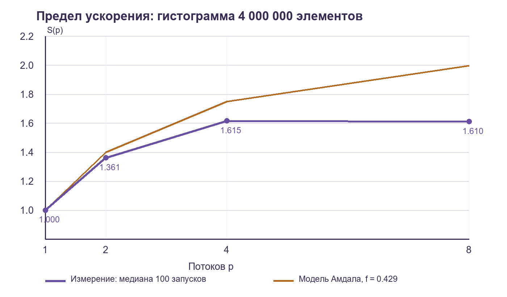

# Предел параллельного ускорения и ложное разделение данных

Практикум 7. Задание 5.

Дисциплина: Языки и технологии программирования.

Выполнил: Митрясов Андрей Александрович. Группа: ВТиИС 22-О. Курс: 2.

Дата выполнения: 08.11.2026.

## 1. Цель и выбор задания

Выбрано задание 5. Оно позволяет исследовать одну гистограмму и один небольшой опыт со счётчиками в Julia, без сетевых служб и нескольких языковых платформ. Julia здесь требуется условием задания. Цель: измерить ускорение при 1, 2, 4 и 8 потоках, оценить последовательную долю, воспроизвести ложное разделение и проверить точное совпадение результатов.

## 2. Стенд и методика

Windows 11 Pro 25H2, Intel Core i5-14400F, 10 физических ядер (6 P + 4 E), 16 логических процессоров, 32 ГиБ DDR5-5200. Схема питания «Высокая производительность». Запуски проводились на рабочем ПК, а не на выделенном стенде: фоновые процессы ОС не отключались, привязка потоков к ядрам не задавалась. Поэтому времена описывают этот запуск и не являются универсальной характеристикой процессора. Julia 1.12.7, обычный запуск с оптимизацией по умолчанию, без внешних пакетов. Во всех процессах задан один поток сборщика мусора `--gcthreads=1`.

Вход содержит 4 000 000 целых `Int64`, 32 000 000 байт. Значение элемента: остаток от `17*i` по модулю 256 плюс 1. Гистограмма содержит 256 корзин. Большой буфер выделяется один раз до замеров, но заново заполняется последовательно внутри каждого замера. Затем каждый поток считает собственную гистограмму на непересекающемся отрезке. Главная задача дожидается всех результатов и последовательно сливает корзины.

Для каждого числа потоков выполнены три прогрева и 100 измерений. Возвращённая гистограмма сравнивается с эталоном по всем 256 элементам. Время включает заполнение, создание задач, подсчёт, ожидание и слияние, но не первоначальное выделение большого буфера и не запись CSV. Порядок процессов 1, 2, 4, 8 фиксирован. Исходные 1600 наблюдений, включая отдельный опыт со счётчиками, сохранены в `results.csv`.

## 3. Ускорение и закон Амдала

| Потоков p | Медиана T(p), с | Минимум..максимум, с | $S(p)=T(1)/T(p)$ | Эффективная f |
| --- | --- | --- | --- | --- |
| 1 | 0.004369550 | 0.003993100..0.005051800 | 1.000 | - |
| 2 | 0.003210150 | 0.002864600..0.004325700 | 1.361 | 0.469 |
| 4 | 0.002705050 | 0.002419000..0.003917600 | 1.615 | 0.492 |
| 8 | 0.002713550 | 0.002446200..0.004256300 | 1.610 | 0.567 |



Прямая последовательная доля на одном потоке равна $f=0{,}429$. В числителе находится время заполнения плюс слияние, в знаменателе полное время. Модель: $S(p)=\frac{1}{f+(1-f)/p}$. При неизменной последовательной части предел равен $S_{\max}=1/f=2{,}33$. Оценка f по измеренной кривой: $f=\frac{1/S(p)-1/p}{1-1/p}$, только для $p>1$.

Оценки не совпадают: формула Амдала относит к эффективной последовательной доле также запуск задач, ожидание, пропускную способность памяти и другие накладные расходы. Медианы отдельных фаз не обязаны складываться в медиану суммы. На восьми потоках ускорение уже не растёт: последовательное заполнение сохраняется, а подсчёт ограничивают память и распределение задач по неодинаковым P- и E-ядрам. Планировщик и фоновые процессы отдельно не измерялись, поэтому их вклад не разделён.

## 4. Ложное разделение

Отдельно каждый поток увеличивает собственный счётчик 500 000 раз. В первом варианте счётчики соседние, во втором расстояние между ними составляет 16 элементов `Int64`, то есть 128 байт. В третьем накопитель остаётся локальным до единственной итоговой записи. Функции инкремента помечены `@noinline`, чтобы компилятор не заменил весь опыт одной формулой. Все варианты выполняют одинаковое число увеличений и проверяют одинаковую сумму.

| Потоков | Соседние, с | Разнесённые, с | Локальные, с | Соседние / разнесённые |
| --- | --- | --- | --- | --- |
| 1 | 0.000942150 | 0.000906250 | 0.000615500 | 1.04 |
| 2 | 0.001304100 | 0.000916000 | 0.000502950 | 1.42 |
| 4 | 0.002708550 | 0.000928700 | 0.000505700 | 2.92 |
| 8 | 0.003908150 | 0.000965650 | 0.000994200 | 4.05 |

Разные потоки не пишут в одну переменную, поэтому логической гонки здесь нет. Однако соседние переменные попадают в общие строки кэша, и право записи передаётся между ядрами. Разнесение уменьшает эту конкуренцию. На 8 потоках соседние счётчики оказались примерно в 4 раза медленнее разнесённых. Счётчики конкретных аппаратных событий не снимались: это контролируемый опыт изменения расположения данных, а не прямое измерение числа инвалидаций кэша.

## 5. Корректность, границы и предел

Все 400 измеренных гистограмм побитово совпали с последовательным эталоном, доля несовпадений 0/400. Каждый поток владеет отдельным массивом корзин, чтение входа совместное, слияние начинается после `fetch`. Поэтому общий изменяемый счётчик отсутствует. Используется целочисленная арифметика, округление при изменении порядка сложения здесь не возникает. Максимум корзины не превышает размер входа и помещается в `Int64`. Пустой массив, один элемент и отрицательный размер проверены отдельно; отрицательный размер вызывает `ArgumentError`.

Сверхлинейного ускорения не получено. Вход 30,52 МиБ больше общего L3 этого ПК, равного 20 МиБ по данным ОС. Добавление потоков не увеличивает общий L3. Малые локальные гистограммы помещаются в кэш и в однопоточном случае. При этом один только объём кэша не является доказательством невозможности сверхлинейного ускорения для всех других входов.

Предел можно сдвинуть изменением алгоритма: не заполнять весь искусственный массив заранее, а вычислять его элементы непосредственно в рабочих задачах, либо распараллелить подготовку. Это уменьшит именно последовательную долю. Простое добавление потоков текущий этап заполнения не ускоряет.

## 6. Воспроизведение и вывод

Перед новым полным запуском нужно сохранить старый CSV под другим именем: программа дописывает результаты. Из корня репозитория выполняются четыре команды:

```text
julia --startup-file=no --gcthreads=1 --threads=1 PLT/practice_7/taskX/task5.jl
julia --startup-file=no --gcthreads=1 --threads=2 PLT/practice_7/taskX/task5.jl
julia --startup-file=no --gcthreads=1 --threads=4 PLT/practice_7/taskX/task5.jl
julia --startup-file=no --gcthreads=1 --threads=8 PLT/practice_7/taskX/task5.jl
```

Каждая команда завершилась с кодом 0 и строкой `TRIALS=100 ... ERRORS=0 EDGE_CASES=3 OK`. Лучшее измеренное ускорение около 1,62 при 4 потоках. Итог ограничен последовательной подготовкой, а ложное разделение заметно замедляет даже независимые счётчики. Правильность и ускорение являются разными свойствами программы.

## Источники

1. Лекция 7 «Параллелизм и асинхронность», разделы 2, 4, 6.
2. Практикум 7, задание 5 и общие требования.
3. Лекция 8 «Производительность: алгоритм, архитектура, реализация, язык», разделы 1.2, 3, 4.
4. [Руководство Julia: многопоточность](https://docs.julialang.org/en/v1/manual/multi-threading/).
5. [Руководство Julia: советы по производительности](https://docs.julialang.org/en/v1/manual/performance-tips/).
